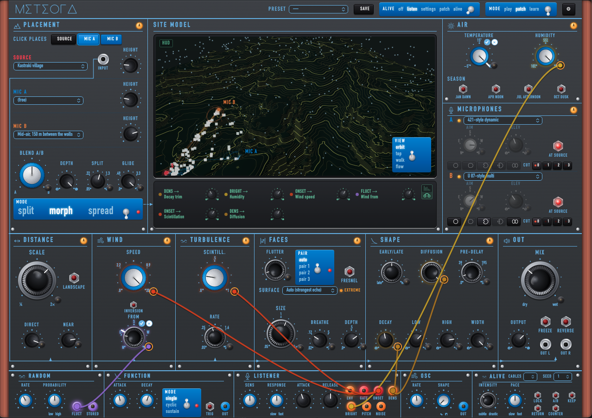
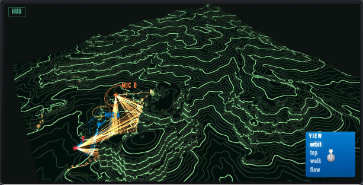

# Meteora 0.3

**A reverb made from a real landscape.** Meteora places your sound among the rock pillars and monasteries of
Meteora, in Thessaly, Greece, and lets you move the microphones through the valley. Echoes come back from the cliff
faces at their real distances, through air that changes with temperature, humidity and wind.

*Simulated from open data · uncalibrated.* No recordings were made on site. The landscape is computed from open
elevation and map data (Copernicus, OpenStreetMap), and where that data is too coarse the pillars are sharpened.
Distances and directions follow the real geometry. Loudness and tone are plausible estimates, not measurements.

Version 0.3 also **listens**: it hears your attacks, density, brightness, pitch and noisiness, and can suggest
settings or move them for you (OFF · LISTEN · SETTINGS · PATCH · ALIVE, from subtle to drastic). Whenever it leaves
the physics, the panel says so with the EXTREME lamp.

Free to use. Closed source. A preview release for the Audio Developer Conference (Bristol, 9–11 November 2026).





## Download

**Meteora-0.3.0-macOS-arm64.zip** from the
[Releases page](https://github.com/Grashopr-888/meteora-releases/releases/latest). The SHA-256 checksum is on the
same page.

To check the download (optional), in Terminal:

```bash
shasum -a 256 ~/Downloads/Meteora-0.3.0-macOS-arm64.zip
```

The result must match the checksum on the release page.

## Requirements

- A Mac with **Apple Silicon** (M1 or later). Intel Macs are not supported in this version.
- **macOS 11 or later** (built for 11.0; tested on macOS 26.2).
- A host that loads **VST3** plug-ins (tested in Ableton Live 12), or the **Standalone** app on its own.
- **Not in Logic Pro or Pro Tools yet.** Logic needs the AU format and Pro Tools needs AAX; neither is built in 0.3.
- About 45 MB of disk space.

## Install

The zip holds `Meteora 0.3.vst3` (the plug-in), `Meteora 0.3.app` (the Standalone app), this README and the licence.

1. **Unzip** the download (double-click it).
2. **The plug-in:** move `Meteora 0.3.vst3` into your VST3 folder, `~/Library/Audio/Plug-Ins/VST3/`.
   In Finder, choose *Go → Go to Folder…* (Shift-Cmd-G) and paste `~/Library/Audio/Plug-Ins/VST3/`.
   Create the folder if it does not exist.
3. **The Standalone app:** move `Meteora 0.3.app` into `Applications`.
4. **Allow macOS to open them** (next section). This is needed once.
5. **Rescan in your host.** In Live 12: *Settings → Plug-Ins*, turn on *Use VST3 Plug-In Custom Folder*, choose
   `~/Library/Audio/Plug-Ins/VST3/` (Shift-Cmd-G in the dialog), and click *Rescan*. Meteora appears under
   *Plug-Ins → VST3 → Grashopr*.

### Allow macOS to open it (the build is not notarised)

Meteora 0.3 is signed for this Mac only ("ad hoc") and not notarised by Apple, because notarisation needs a paid
Apple developer membership. macOS therefore blocks it the first time, with a message such as *"Meteora 0.3" cannot
be opened because Apple cannot check it for malicious software*. Choose one of the two ways below.

**A. One line in Terminal (recommended; covers both files).** Open *Terminal* (in Applications → Utilities), paste
this line and press Return:

```bash
xattr -dr com.apple.quarantine ~/Library/Audio/Plug-Ins/VST3/"Meteora 0.3.vst3" "/Applications/Meteora 0.3.app"
```

It removes the "downloaded from the internet" flag from the two files and changes nothing else. If you put the
files somewhere else, change the paths.

**B. System Settings (no Terminal).** Open `Meteora 0.3.app` once and close the warning. Then open
*System Settings → Privacy & Security*, scroll to *Security*, and click **Open Anyway** next to the message about
Meteora 0.3; confirm with your password. For the plug-in, do the same after your host has tried to load it and
macOS has shown the warning. (On macOS 15 and later, Control-click → Open no longer skips this step.)

Why this is safe to do for this file: the checksum on the release page lets you confirm that the zip is the one
published. Notarisation is planned for version 1.0, after which this step goes away.

### First run

- **Standalone:** open `Meteora 0.3.app`. macOS asks for **microphone access**: allow it, so the app can hear your
  audio interface. Then *Options → Audio/MIDI Settings*: choose your interface, input 1, and a buffer of
  64–128 samples. Use headphones, or keep the output away from the microphone.
- **In a DAW:** put Meteora on an audio track or a return track. Start with a factory preset from the preset menu
  (the *Places* and *Air* groups are good first stops).
- **"?" (LEARN mode)** explains every control on the panel: what it is, what you hear, what the screen shows.

## Using Meteora in Ableton Live

Live builds its own device panel only for plug-ins with up to 64 parameters. Meteora has 106, all of them
automatable, so its device opens with an **empty panel** and the automation chooser lists only *Device On* and the
control you touched last. To automate a control:

1. Move it on Meteora's panel: it appears in the track's automation chooser. Draw or record automation for it.
2. To keep a set of controls at hand, click **Configure** in the device's title bar, then move the controls on
   Meteora's panel; each becomes a slider in Live's device panel, saved with the Set. Click Configure again to
   finish.

While the Meteora window has keyboard focus, **the space bar does not reach Live** (a known issue of the web view the
panel is built with). Click in Live's arrangement to give the focus back.

## Presets and settings

- **41 factory presets** in groups: Places, Air, Faces, Shape, Mics, Patches, Alive and Utility.
- **Your presets** are saved in `~/Library/Application Support/Meteora/Presets`.
  This folder is **shared by every version of Meteora** you have installed. A 0.3 preset opened in an older
  version loads without the parts that version does not know.
- Global settings (patching on or off, modules, default mode, cable look, panel theme) are in
  `~/Library/Application Support/Meteora/config.json`, edited from the gear button on the panel.
- *Export ALIVE log* (settings page) writes what the guide did to `~/Library/Application Support/Meteora/Logs`.
  Attach it to a bug report about the ALIVE modes.

**Versions install side by side.** Each version of Meteora is a separate plug-in with its own name ("Meteora 0.3",
later "Meteora 0.4" or "Meteora 1.0"). Installing a new version never replaces this one, so your projects keep
opening with the version they were made with. Move a sound to a newer version through a preset.

## Uninstall

Delete these two:

- `~/Library/Audio/Plug-Ins/VST3/Meteora 0.3.vst3`
- `/Applications/Meteora 0.3.app`

Your presets, settings and logs stay in `~/Library/Application Support/Meteora/`. Delete that folder too only if
no other version of Meteora is installed and you no longer want your presets.

## Known limits of 0.3

This is a preview. Please report what you find (next section).

- **Apple Silicon and VST3 / Standalone only**: no Intel, AU (Logic), AAX (Pro Tools) or Windows yet.
- **Not notarised**: the one-time step under *Install*.
- **CPU:** about 12 % of one core of an M1 Max at 48 kHz with a 128-sample buffer, two microphones and both tails
  (ALIVE adds about one point). Older or busier machines may need a larger buffer; if you hear clicks, try 256
  samples and tell us your Mac, host and buffer size.
- **The site model can stutter** at times while it animates; the audio is not affected.
- **The space bar** does not reach the host while the Meteora window has focus (see above).
- **The listener** is tuned on test signals, not yet on many real recordings. A strummed chord may count as two or
  three attacks, and the first notes of a phrase can read as "new" for a while.
- **The ALIVE guide's choices are first guesses**, not yet tuned by ear. At drastic intensity the plugin's own
  cables can be extreme; LOCK holds the current state, RETURN goes back to your settings.
- **Shared preset folder** (see *Presets and settings*).

## Reporting bugs and ideas

Open an issue on this repository's
[Issues page](https://github.com/Grashopr-888/meteora-releases/issues). Please include:

- your Mac (model and chip) and macOS version,
- the host and its version (or "Standalone"), sample rate and buffer size,
- what you did, what you heard or saw, and what you expected,
- the preset, if any, and for the ALIVE modes the exported ALIVE log.

## About

Meteora is an artistic-research project by Grashopr. It asks what a reverb can be when its space is a real place
you can move through, computed from open data.

Meteora is a UNESCO World Heritage Site and a living monastic community. This plug-in is an acoustic model made from
public data. It is not affiliated with or endorsed by the monasteries of Meteora or the Holy Metropolis of
Stagoi and Meteora.

## Licence and credits

Meteora is free to use, including in commercial music. It may not be sold, redistributed or reverse engineered.
The full terms are in [LICENSE.txt](LICENSE.txt).

Built with the [JUCE](https://juce.com) framework under the JUCE Starter licence, and with
[three.js](https://threejs.org) (MIT). Notices for these and other third-party components:
[THIRD-PARTY-NOTICES.txt](THIRD-PARTY-NOTICES.txt).

The landscape is made from:

- **Copernicus DEM**: produced using Copernicus WorldDEM-30 © DLR e.V. 2010-2014 and © Airbus Defence and Space
  GmbH 2014-2018 provided under COPERNICUS by the European Union and ESA; all rights reserved.
- **OpenStreetMap**: contains information from [OpenStreetMap](https://www.openstreetmap.org/copyright), made
  available under the Open Database License (ODbL). © OpenStreetMap contributors.

The site data inside the plug-in is open under the ODbL. Details, and where to download the OpenStreetMap-derived
data: [DATA-NOTICES.md](DATA-NOTICES.md).

VST is a registered trademark of Steinberg Media Technologies GmbH. Ableton and Live are trademarks of Ableton AG;
Apple, Mac, macOS, Logic Pro and Apple Silicon are trademarks of Apple Inc. Other names are the property of their
owners.
